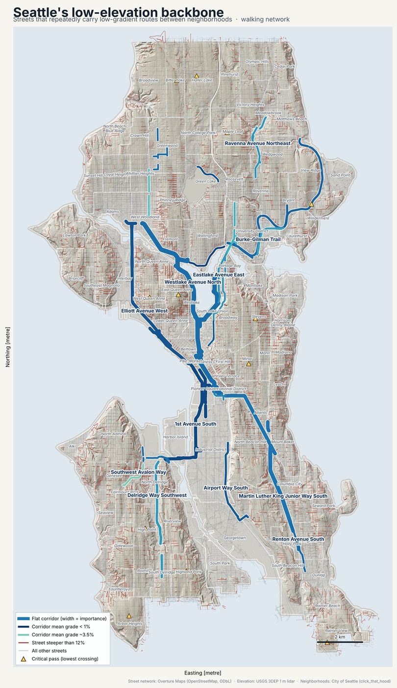

# Flatten Seattle

**[nataliewalls.com/flatsea](https://nataliewalls.com/flatsea/)**: the
flattest walking or cycling route between any two places in Seattle, and
every route between it and the shortest one.



This is a Seattle port of **[Flatten SF](https://github.com/almostimplemented/flattensf)**
by [Drew Edwards](https://almostimplemented.com) (MIT licence). The method,
the routing engine and the route finder are all theirs; this fork swaps in
Seattle's data. The original README, with the full methodology, is kept as
[`README.upstream.md`](README.upstream.md).

## What changed for Seattle

Following the upstream README's "Other cities" checklist:

| Setting | San Francisco (upstream) | Seattle (this fork) |
|---|---|---|
| Bounding box (`config.SF_BBOX`) | -122.52 to -122.33, 37.695 to 37.835 | -122.44 to -122.23, 47.49 to 47.74 |
| Projection | EPSG:26910 (UTM 10N) | unchanged: Seattle is in the same zone |
| 1 m lidar (`sources.LIDAR_PROJECT`) | `CA_SanFrancisco_B23`, 4 tiles | `WA_KingCounty_2021_B21`, 8 tiles (x54-55, y526-529) |
| 10 m cross-check DEM | `n38w123` | `n48w123` |
| Neighborhoods | 37 SF planning neighborhoods | 90 Seattle neighborhoods (Code for America `click_that_hood`) |
| Overture release | `2026-08-19.0` (no longer hosted) | `2026-10-21.0` |
| Bike facilities (`bikeways.BIKEWAYS_GEOJSON`) | SFMTA Bike Network, `data/raw/` | SDOT Existing Bike Facilities, committed in `data/sources/` |
| Default trip | Trick Dog to the Golden Gate Park dragon | Ballard Locks to the Space Needle |
| Branding | Flatten SF, flattensf.com | Flatten Seattle, nataliewalls.com/flatsea |

Identifiers such as `SF_BBOX` and the `sf_flat_routes` package name are kept
so the fork stays easy to compare with, and merge from, upstream.

## Building

Python 3.10+, as upstream:

```bash
python -m venv .venv && source .venv/bin/activate
pip install -r requirements.txt
python -m sf_flat_routes download       # ~2.3 GB: 8 lidar tiles, Overture extract
python -m sf_flat_routes build-network  # street graph, elevation, edge metrics
python -m sf_flat_routes analyze        # pairs, Pareto, corridors, passes
python -m sf_flat_routes map            # maps, and the route finder in site/
```

`site/` is committed already built. The blog
([natalieflora/blog](https://github.com/natalieflora/blog)) pins a commit of
this repository in `flatsea.lock.json` and copies `site/` into
`/flatsea/` at build time, checking every file's SHA-256. After rebuilding
here, push, then run `pnpm flatsea:update <commit>` in the blog.

### Bike facilities

The route finder's *prefer calm streets* weighting uses SDOT's
[Existing Bike Facilities](https://catalog.data.gov/dataset/existing-bike-facilities)
(City of Seattle open data, no restrictions on use). The City's feature
service is not reachable from every build environment, so a cached copy is
committed at `data/sources/seattle_bike_facilities.geojson`:

```bash
python scripts/fetch_seattle_bikeways.py   # refresh it by hand (stdlib only)
```

The [`refresh-bikeways`](.github/workflows/refresh-bikeways.yml) workflow
re-fetches it on the 2nd of every month and opens a pull request when SDOT has
changed something (scheduled runs only fire on the repository's default
branch). A new copy reaches the site only after the pipeline is rerun.

SDOT's categories map onto the route finder's facility codes like this:

| SDOT category | Facility | Counts as (of its length) |
|---|---|---|
| Off-street trail (`BKF-OFFST`) | `path` | 0.8 |
| Protected bike lane (`BKF-PBL`) | `separated` | 0.8 |
| Buffered bike lane (`BKF-BBL`) | `buffered_lane` | 0.9 |
| Neighborhood greenway (`BKF-NGW`) | `neighborway` | 0.9 |
| Bike lane (`BKF-BL`), climbing lane (`BKF-CLMB`) | `lane` | 1.0 |
| Sharrows (`BKF-SHW`) | `route` | the street's own rating, softened |

Streets with no facility keep their road-class rating (a busy arterial counts
as 1.4 to 2). Segments under construction are left out.

## Limitations of the port

Everything in the upstream "Limitations" section applies. In addition:

- **Bike facilities are matched by shape, not by id.** SDOT's segments are
  snapped to the Overture street graph geometrically (within 12 m and 25
  degrees over at least half an edge), as upstream does for SFMTA, and only
  onto edges of a fitting kind: a painted lane never lands on the sidewalk
  beside it, and a trail never lends its rating to the road next to it. A
  climbing lane (bike lane uphill, sharrows downhill) counts as a lane in
  both directions.
- **Neighborhood boundaries are an older mirror** of Seattle's neighborhood
  map with no stated vintage, not the city's current Community Reporting
  Areas. They seed the analysis's access points and clip the network.
- **The `validate` and `report` stages are still San Francisco's.** Their
  ground truth (known steep streets, the Wiggle, the Embarcadero) and their
  prose describe SF, so they have not been run for Seattle. Seattle
  equivalents (published grades for its steepest streets, the Burke-Gilman
  and Elliott Bay trails as known flat corridors) are a to-do.
- Upstream's tests were written against San Francisco data. On the Seattle
  build 124 pass, 3 skip and 6 fail; the 6 failures look for San Francisco
  streets and places (Filbert Street, Valencia Street, Slow Streets) and
  need Seattle equivalents.

## Licence and attribution

Code: MIT, © 2026 sf-flat-routes contributors (see [`LICENSE`](LICENSE)),
including Drew Edwards's original work. Street geometry is © OpenStreetMap
contributors, ODbL 1.0, via Overture Maps; the built route finder's street
graph is a derived database under the same licence. Places are Overture
Maps (CDLA-Permissive 2.0). Elevation is USGS 3DEP, public domain.
Neighborhood boundaries come from the City of Seattle via Code for
America's `click_that_hood`; check their terms before reusing them
separately. Leaflet is BSD-2-Clause.
